# 文件管理器 · 原生 Qt 版

这是 **Qt 5 Widgets / C++ 原生文件管理器**。不依赖浏览器或 Python，
直接读写本机文件。

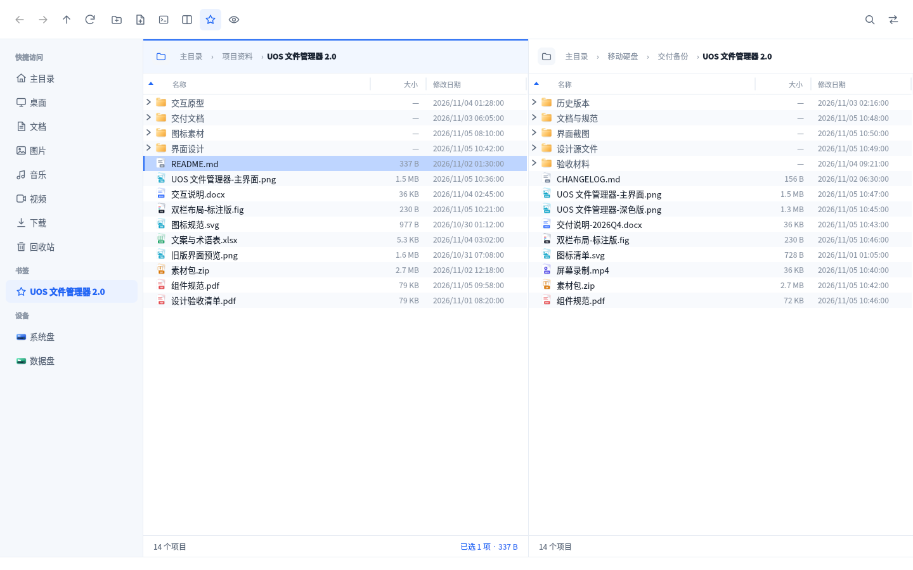

## 已实现

### 浏览与搜索

- 左右双窗格，独立路径、历史、排序和选择；支持顶栏单栏/双栏切换
- 单栏模式下选中行使用与双栏相同的蓝色选中效果；单栏不显示活动窗格边框
- 当前目录自动刷新，并尽量保留选中项和滚动位置；F5 可手动刷新
- 深层路径自动折叠中间层级，面包屑不会把当前窗格撑宽而挤压另一窗格；
  “…”菜单可以跳转到被折叠的路径，省略号不显示下拉箭头
- 路径面包屑悬停时只高亮文字，不显示底纹，避免和窗格高亮线冲突
- 文件夹左侧有“>”展开标记；点击在当前窗格内展开该文件夹的一层子项，
  形成缩进树形结构；不会自动递归展开，子文件夹需要用户再次点击展开；
  再次点击“v”收起，并同时收起其下级展开状态
- 展开的子项仍使用普通文件行，支持选择、双击打开、右键、拖放和排序
- 隐藏文件：顶栏眼睛按钮或 `Ctrl+H`，状态持久化
- **文件名/文件内容搜索**：点击顶栏搜索图标（或 `Ctrl+F`）后，搜索框出现在当前
  聚焦窗格的路径栏；默认递归扫描文件名，结果以普通文件列表样式显示，名称列只显示文件名。
  搜索框右侧可切换“文件名/文件内容”：
  - 文件内容搜索读取本机文搜搜的索引，并先检查当前文件夹是否在文搜搜的索引目录内；
  - 未安装文搜搜时，会显式弹窗提醒安装文搜搜、建立索引后再使用文件内容搜索；
  - 文搜搜已安装但未建立索引，或当前文件夹未加入索引时，也会弹出相应提醒；
  - 文件内容结果仍以普通文件列表显示，只显示文件名，不显示相对路径。
- 关闭搜索框恢复原目录
- **空格预览**：选中文件按空格，支持图片、文本、**Word / Excel / PowerPoint**、
  **ZIP / TAR**；其他类型显示文件信息和“用默认应用打开”入口
- **办公文档预览**：DOCX 使用白底页面和标题层级排版；XLSX 显示表格网格；
  PPTX 以幻灯片卡片展示。DOC/XLS 通过 LibreOffice 转换或文本回退预览；
  WPS/ET/DPS 优先按 OOXML 解析，否则在预览窗口中心显示加载转圈，后台转换并缓存结果；
  旧版格式的版式可能不完整
- **压缩包预览**：ZIP 内部读取，无需解压；TAR/TGZ 通过系统 tar 列出内容；
  使用与普通文件夹一致的文件图标、名称、大小、修改时间和斑马纹列表
- **预览切换**：预览窗口中按 ↑/↓ 在当前窗口内直接切换上一个/下一个文件，
  不关闭再重建预览窗口，不会闪烁
- **PDF / OFD 预览**：PDF 使用 poppler 渲染页面，OFD 解析文档内文本/图片；
  文件较大时在窗口中心显示加载动画
- 名称/大小/修改日期列宽可拖动，表头分隔线；**每行 24px 紧凑行高**、
  浅色斑马纹，图标随行高缩小显示
- 文件大小、修改日期字号加大；文件图标和文件名保持不变
- 日期统一为 `yyyy/mm/dd hh:mm:ss`

### 文件操作

- 复制 / 移动后台队列：进度、暂停 / 继续 / 取消、传输中心
- **传输速度和剩余时间**：传输条和传输中心显示实时速度与 ETA
- **文件冲突处理**：目标已有同名项目时弹出确认，可选择
  **复制并改名 / 替换 / 跳过 / 合并文件夹**，并可应用到全部冲突。
  合并文件夹时同名文件保留两者，不静默覆盖；复制到原目录也有明确提示
- **回收站**：侧栏打开回收站页面，可查看原位置、删除时间、还原或清空；
  文件使用与主列表一致的图标、24px 紧凑行高和斑马纹；还原遇到同名项目自动改名
- **打开方式**：文件右键选择其他应用，可设为该类型的默认应用
- **权限/属主编辑**：属性页可修改所有者/用户组和读/写/执行权限；
  没有权限时可用 `pkexec` 管理员授权
- 桌面 `.desktop` 启动器显示中文应用名和真实应用图标；双击启动
- `Ctrl+C` / `Ctrl+V` / `Ctrl+X` 文件剪贴板，复制/剪切时源行有短暂高亮反馈；
  同时写入 `text/uri-list`、`text/plain` 和 GNOME 文件剪贴板格式，其他软件可直接读取
- 拖放复制/移动：拖动到另一窗格默认复制，**松开鼠标时按住 Alt 为移动**；
  拖动过程中再按下 Alt 也会生效，Shift/Ctrl 不再触发移动
- 新建文件夹 / 新建文件为顶栏纯图标按钮，与刷新按钮同尺寸；新建文件夹图标加号居中
- 顶栏新增终端图标；窗格空白处右键增加“在终端打开”，自动定位到当前文件夹
- **压缩包操作交由系统归档管理器**：
  - 单个 ZIP/TAR/TAR.GZ/7z/RAR 右键“解压”，打开系统归档管理器的解压界面；
  - 选中文件/文件夹右键“压缩”，打开系统归档管理器的压缩界面；
  - 选择格式、压缩级别、密码等由归档管理器负责；
  - 依赖系统 `deepin-compressor`（UOS 自带归档管理器），缺失时给出明确提示
- 文件、文件夹属性查看

### 外观与弹窗

- **确认/冲突/警告弹窗统一为现代「浮层卡片」风格**：圆角卡片、图标、
  主操作与取消按钮，按钮纯中文文字，不使用系统勾/叉图标或英文标准按钮
- 文件列表图标保持叠纸 + 彩色角标方案（随紧凑行高缩小显示）
- **应用图标**改为简洁的白色文件夹 + 三条列表线，蓝色渐变底；不再体现双栏
- 设备栏显示系统盘、数据盘和自动检测的 U 盘/移动硬盘；可移动磁盘可弹出
- 书签：顶栏星标添加/移除，侧栏点击进入；右键可重命名或移除，`Ctrl+D` 切换
- 设备每 3 秒检测自动刷新；可移动磁盘弹出走 `udisksctl` / `gio` / `umount`，
  弹出在后台执行，成功后立即切回主目录，不阻塞界面或显示失效路径
- 单实例运行；WPS 等应用“打开文件所在位置”会复用已运行窗口，立即定位并选中文件，
  不再等待新进程启动
- 通过 DDE 兼容 shim 接管 `dde-file-manager --show-item/--show-items`：
  WPS 的 D-Bus `org.freedesktop.FileManager1.ShowItems` 请求最终交给本文件管理器，
  并选中文件；普通 DDE 文件管理器启动不受影响，卸载时恢复原 DDE 命令
- 安装时注册为 `inode/directory` 默认打开方式，并提供 `--reveal/--select/--show`，
  让 WPS 等应用优先打开本文件管理器
- 浅色主题；选中文件使用更明显的深蓝背景；底部项目数/选中项文字 12px 加粗；
  配置、窗口尺寸、单栏/双栏、隐藏文件、书签名称持久化
- 快捷键：F5 复制到对栏，F6 切换窗格，F2 重命名，Delete 移到回收站，
  Ctrl+F 在当前窗格递归搜索，Ctrl+L 输入路径，Ctrl+D 书签，
  Ctrl+H 隐藏文件，空格预览，Alt+←/→/↑ 导航

### 文件类型图标

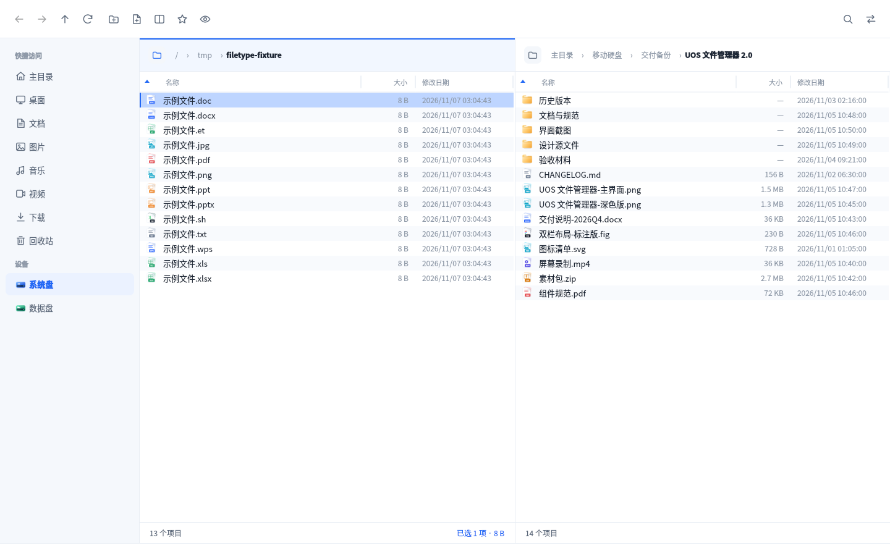

### 桌面应用名称与图标

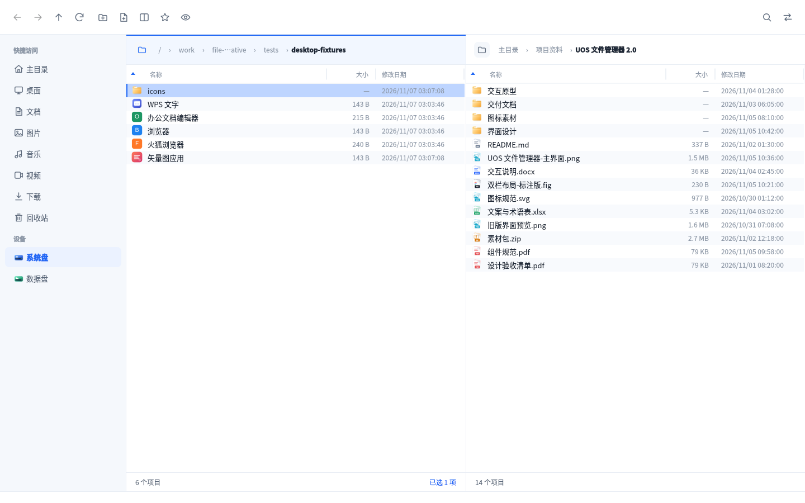

### 单栏模式

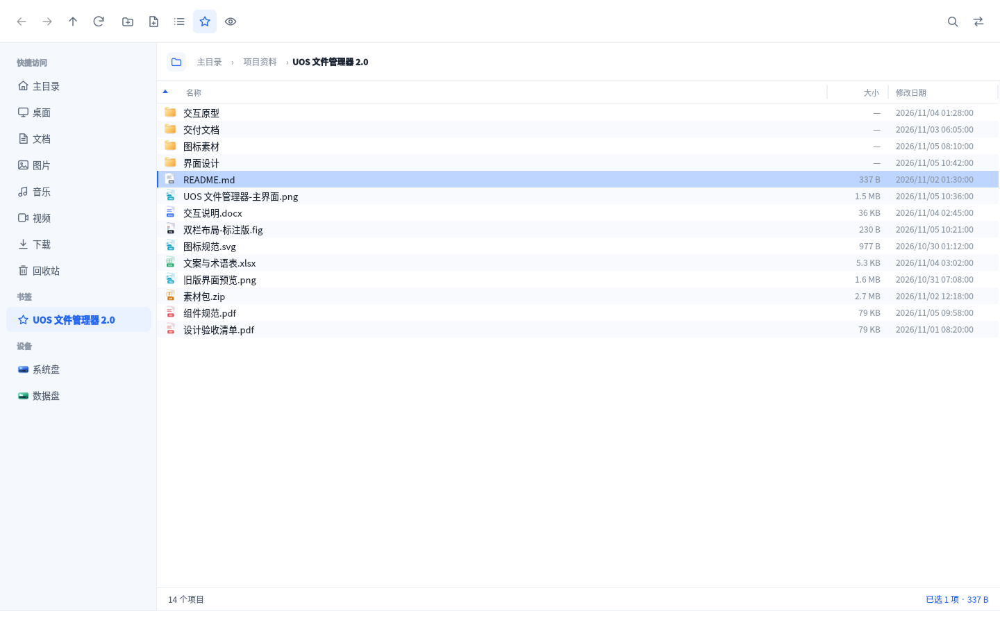

### 文件名搜索（窗格内）

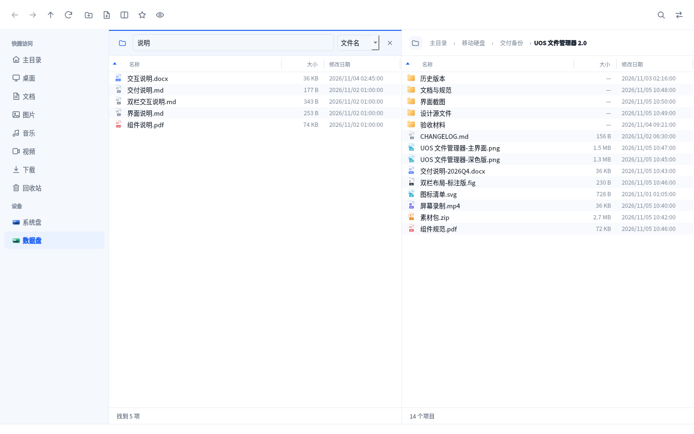

### 文搜搜文件内容搜索

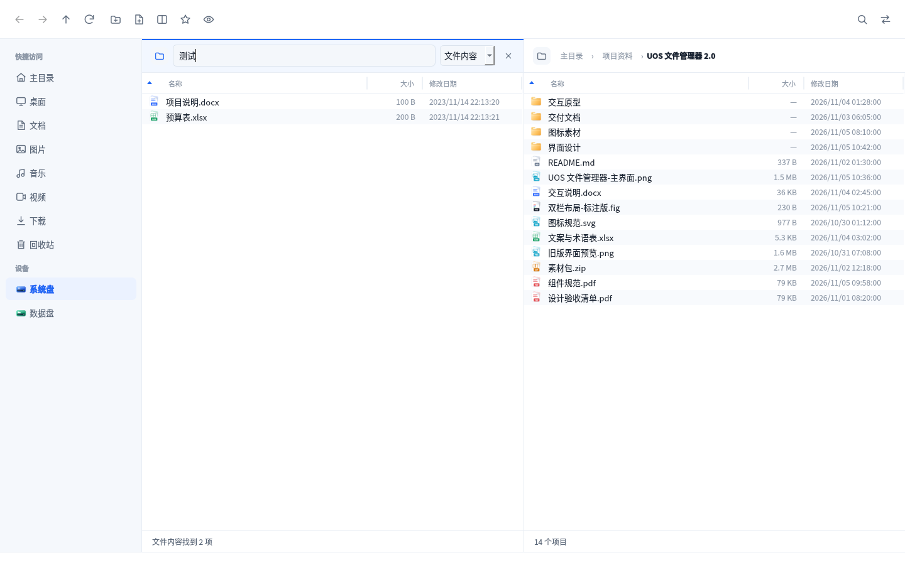

### 办公文档预览

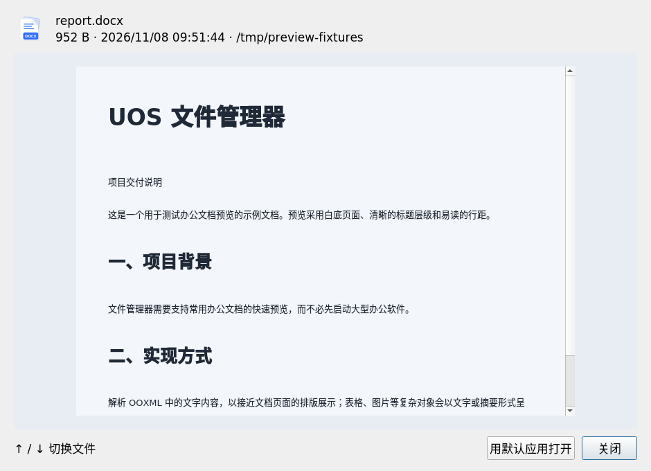

### WPS / ET 预览

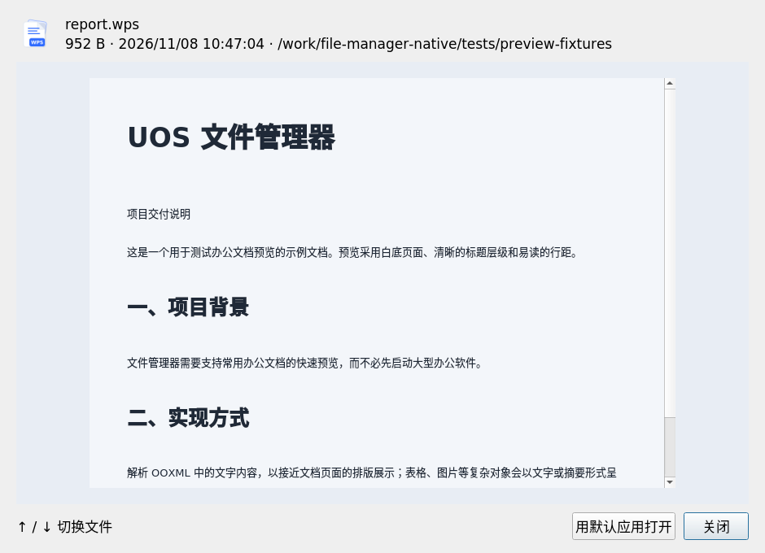

### PDF 预览

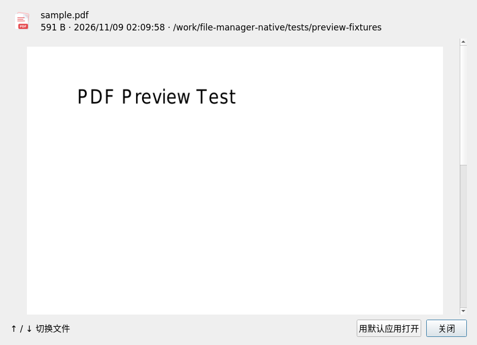

### OFD 预览

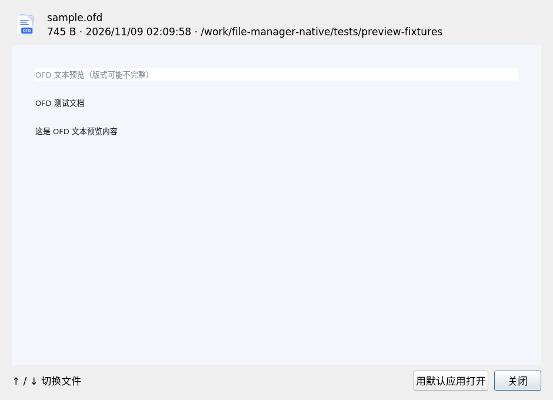

### 压缩包预览

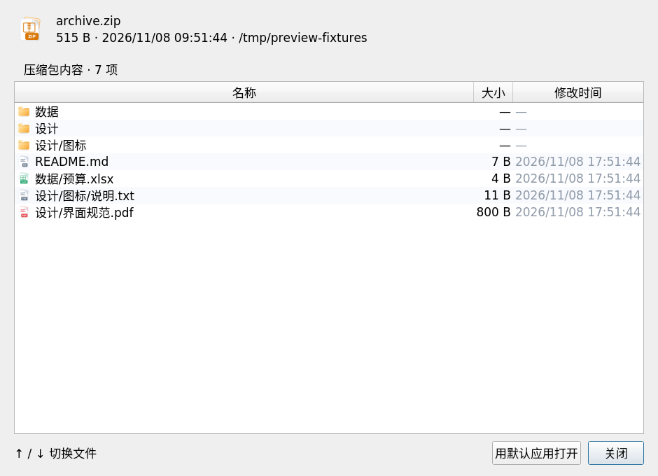

## 安装（UOS / Debian arm64）

```bash
sudo dpkg -i uos-dual-pane-file-manager_2.9.3_arm64.deb
```

从应用菜单启动「文件管理器」，或：

```bash
uos-dual-pane-file-manager
```

卸载：

```bash
sudo dpkg --purge uos-dual-pane-file-manager
```

## 依赖

- Qt 5.11+ 的 Core / Gui / Widgets / Svg 运行库（UOS 20 自带）
- 推荐 `xdg-utils`、`libglib2.0-bin`：打开方式、默认关联和 `gio launch`
- 可移动磁盘弹出优先 `udisksctl`（udisks2），回退 `gio` / `umount`
- 权限/属主编辑使用系统 `chmod`/`chown`；管理员模式需要 `pkexec`
- 办公文档/压缩包预览使用内置 ZIP 解析和系统 `tar`；压缩包创建/解压交由
  `deepin-compressor`（系统归档管理器）处理
- PDF 页面渲染依赖 `poppler-utils`（pdftoppm/pdftotext）
- 文件内容搜索依赖 `libsqlite3-0`，并读取已安装的文搜搜索引；文搜搜未安装时会显式提醒安装并建立索引，
  不影响文件名搜索和文件管理功能

在 Debian 10 buster arm64、Qt 5.11.3 上构建和验证。

## 从源码构建

在装有 Docker 的开发机上：

```bash
docker build -t uos-dual-pane-file-manager-builder -f packaging/Dockerfile.builder .
./packaging/build_deb.sh
```

产物在工作区 `dist/` 目录。构建在 arm64 Debian 10 容器中完成，
与 UOS 20 的 glibc / Qt 5.11 基线一致。

也可以直接在装有 Qt 5.11+ 开发包的 Debian arm64 环境里：

```bash
cmake -S . -B build -DCMAKE_BUILD_TYPE=Release
cmake --build build --parallel
```

## 安全与行为说明

- 操作真实文件。默认同名冲突不会静默覆盖，会弹出确认；“替换”会删除目标同名项目。
- 合并文件夹时同名文件保留两者；复制到自身目录只生成改名副本。
- 普通目录删除会先尝试系统回收站（`gio trash`），否则回退 XDG 回收站；
  可移动磁盘上的删除为彻底删除，不会进入回收站。
- 删除确认框默认按钮为“确认/彻底删除”，按回车直接执行；取消需点击“取消”。
- 右键菜单提供“彻底删除”；可移动磁盘只显示彻底删除。
- 回收站还原时原位置有同名项目会自动改名；跨分区还原可能受文件系统限制。
- 传输任务在后台线程执行；关闭主窗口会先询问并取消正在进行的任务。
- 自动刷新依赖文件系统通知；网络共享等可能不触发，仍可 F5。
- 文件名搜索只匹配文件名，不搜索文件内容；结果上限 5000 项。
- 文件内容搜索只使用文搜搜已建立的索引；当前文件夹必须在文搜搜索引目录内，且需要文搜搜
  1.2.x 的数据库格式和 `/opt/wensousou/lib/libsimple.so` 分词组件。
- 空格预览支持图片、文本、DOC/DOCX/XLS/XLSX/PPTX、WPS/ET/DPS、PDF、OFD、ODT 和
  ZIP/TAR；DOC/XLS/PPT 依赖 LibreOffice 转换或文本回退，OFD 为文本/图片级预览，
  版式可能不完整；7z/RAR 仍显示信息或使用默认应用打开。
- 当前没有标签页、图片缩略图网格、网络共享/MTP，也没有注册为系统默认文件管理器。

## 技术结构

```
src/mainwindow.*     主窗口、工具栏、侧栏、冲突预检、传输条、剪贴板
src/filepane.*       单窗格 UI、历史、排序、面包屑、文件监听、隐藏文件、F5
src/filetableview.*  文件列表拖放、空格预览快捷键
src/directorymodel.* 异步目录/递归搜索模型，隐藏文件过滤，.desktop 显示名
src/desktopentry.*   .desktop 名称 / 图标 / MIME / 启动
src/transfertask.*   后台复制/移动线程、冲突策略
src/transfermanager.* 任务队列、速度/剩余时间计算
src/transferdialog.* 传输中心
src/trashdialog.*    回收站查看/还原/清空
src/openwithdialog.* 打开方式与默认关联
src/propertiesdialog.* 权限、属主、用户组编辑
src/ejecttask.*      异步弹出磁盘
src/fulltextsearch.* 只读访问文搜搜 FTS 索引、索引目录检测
src/singleinstance.* 单实例 socket、外部定位/选中文件
src/previewdialog.*  图片/文本/办公文档/压缩包空格预览
src/ziparchive.*     内置 ZIP 目录与条目读取
src/moderndialog.*   现代浮层卡片确认框
src/uidialogs.*      中文确认/警告/冲突对话框
src/iconprovider.*   文件类型、设备、应用图标
src/theme.*          浅色主题
src/fileoperations.* 回收站、新建、重命名、权限、弹出磁盘
src/formatters.*     大小、日期、速度、时长格式化
```

## License

MIT，见 `LICENSE`。
